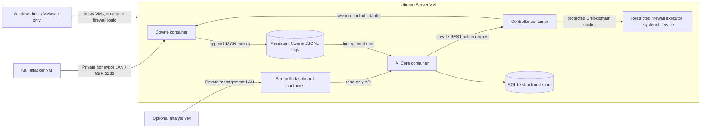
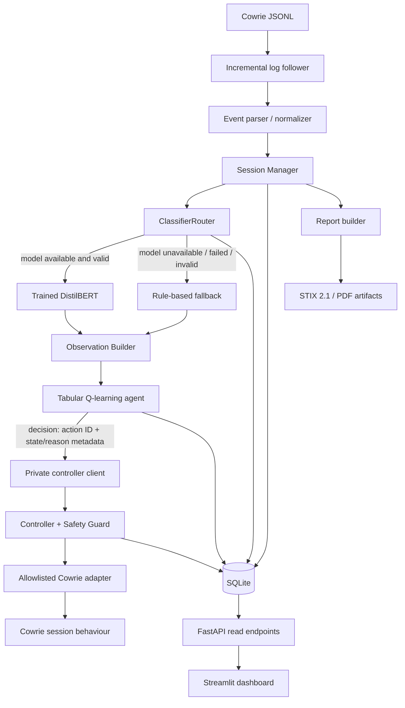

# System Architecture

**Project:** Autonomous Cyber Deception Platform Using Reinforcement Learning for Adaptive Honeynet Orchestration  
**Status:** Agreed target architecture; implementation details must be verified against the repository and pinned component versions.

## 1. Architecture goals

The architecture separates telemetry collection, AI decision-making, action execution, and containment authority. The key safety rule is that the Q-learning agent proposes only predefined deception actions; a separate controller validates and applies them. Hard containment does not depend on the ML model or the RL agent.

The platform runs inside an isolated Ubuntu virtual machine. Windows runs VMware Workstation only.

## 2. Deployment topology



### Deployment components

| Component | Responsibility | Authority boundary |
|---|---|---|
| Cowrie container | Emulates SSH interaction and writes event logs/session data | No host firewall authority; attacker commands are emulated, not executed on the Ubuntu host |
| AI Core container | Log following, normalization, session management, model/fallback routing, observation building, Q-learning, reporting, and FastAPI read API | No direct host firewall authority; no direct arbitrary Cowrie mutation |
| Controller container | Validates action requests, applies allowlisted per-session deception operations, coordinates safety and containment | Narrowly scoped access to approved adapters only |
| Cowrie session-control adapter | Bridges validated controller requests to the selected Cowrie version's supported per-session behaviour controls | Must be implemented and verified for the pinned Cowrie version; JSON logging is not itself a session-mutation API |
| Ubuntu firewall executor | Performs narrowly defined block/unblock operations for the Cowrie service | Ubuntu VM only; fixed request schema and restricted local IPC; no arbitrary shell or firewall text |
| Streamlit dashboard | Displays platform status, sessions, predictions, decisions, action results, containment events, and report downloads | Read-only view of platform APIs; no direct RL or firewall execution |
| SQLite | Stores normalized events and structured platform records | One controlled AI Core writer; not an event bus |
| Cowrie JSONL log | Retains original Cowrie telemetry | Raw source of truth; preserve original records |

The suggested deployment uses four application containers: `cowrie`, `ai-core`, `controller`, and `dashboard`. The firewall executor is a small systemd service inside Ubuntu, not a privileged application container.

## 3. Internal AI Core structure

Keep the AI Core components as modules in one controlled AI Core process unless a later approved architecture decision changes this. Within AI Core, use typed Python functions/data contracts rather than introducing a separate HTTP microservice for every module.



### 3.1 Event Normalizer

Reads Cowrie's append-only JSONL output incrementally. It converts each complete raw record to a validated internal event while retaining the original event and provenance. It owns parsing, normalization, validation, internal event identity, and ingestion position. It does not classify intent or choose deception actions.

### 3.2 Session Manager

Groups events by Cowrie's `session` value. It maintains active, evolving session records, ordered command history, summary counters, and closure information. A session snapshot can be useful before the session is complete. `full_session` means the cumulative command text observed so far; it does not mean the session has ended.

### 3.3 ClassifierRouter

Provides one stable classification interface. It loads the existing trained model once at process start. When the model cannot load, inference fails, tokenization fails, a timeout occurs, or the output is invalid, it routes to the deterministic rule fallback. A valid `Harmless` prediction is not a model failure. Fallback evidence must be identified as heuristic and must not be presented as calibrated model probability.

### 3.4 Observation Builder

Maps validated classification output and session behaviour to the approved six-feature state representation. It keeps risk distinct from model confidence and handles multi-label predictions according to a documented rule.

### 3.5 Tabular Q-learning agent

Uses the 144-state discrete space and nine approved action IDs. It returns a decision record. It does not execute operating-system commands, modify Cowrie directly, terminate a session, or perform IP blocking.

### 3.6 Controller and Safety Guard

The Controller validates each requested action against the session state, action allowlist, parameters, expiry, and idempotency requirements. It records request and final execution status separately. The Safety Guard independently evaluates configured hard safety conditions. A safety decision must remain available even if DistilBERT or the rule classifier is unavailable.

### 3.7 Cowrie adapter

Maps an approved action ID to a preconfigured per-session behaviour change. The exact bridge must be implemented against the selected Cowrie version. Begin with no-op and one verified behaviour change; do not assume Cowrie's JSON output interface can mutate live sessions.

### 3.8 Ubuntu firewall executor

A restricted systemd service inside Ubuntu performs fixed block/unblock operations for the Cowrie published SSH endpoint. It accepts structured requests over protected local IPC, validates source IP/session/target scope, and performs only allowlisted operations. The controller must not receive general host-administration access.

### 3.9 Dashboard and reporting

The dashboard reads platform data through FastAPI endpoints and displays source/session details, classifier method, RL decision, controller result, containment result, and report status. Report generation uses stored session/event records and produces STIX 2.1 and PDF artifacts.

## 4. End-to-end event and decision lifecycle

1. An attacker test client connects to Cowrie over the isolated honeypot LAN.
2. Cowrie writes JSON event records to its persistent JSONL log.
3. The incremental follower reads only complete lines and maintains a restart-safe file checkpoint.
4. The normalizer parses and validates each event, creates an internal `event_uid`, and preserves raw JSON and source position.
5. The Session Manager inserts the event idempotently and updates the session keyed by Cowrie session ID.
6. As command events arrive, the Session Manager updates the cumulative ordered command history and current session snapshot.
7. At the separately validated inference checkpoint, the ClassifierRouter classifies the cumulative text using the exact training preprocessing, or uses the rule fallback.
8. The Observation Builder converts classification and behaviour features into a valid discrete state.
9. The Q-learning agent chooses one of the nine approved action IDs and records its decision.
10. The Controller validates and applies the action using the Cowrie adapter. It records `accepted` separately from `applied`.
11. In parallel, the Safety Guard checks its independent containment rules. If a containment trigger fires, the controller marks the session contained, requests a per-session disconnect, requests a scoped source-IP block from the Ubuntu firewall executor, verifies the results, and records the containment event.
12. The dashboard displays the session and action/containment lifecycle. Closed-session data can be used to produce STIX 2.1 and PDF reports.

The sequence above describes the target flow. Phase 7 implements only the event follower, normalizer, and session store/manager; classifier, RL, controller and containment integration belong to later phases.

## 5. Incremental session model

Cowrie events arrive over time. Therefore, a session is not a single complete object delivered at connection close. It is an evolving record.

Example lifecycle:

| Event received | Current command text | Session state |
|---|---|---|
| Session connect | Empty | Active; incomplete |
| Command `id` | Cumulative text containing `id` | Active; incomplete |
| Command `uname -a` | Cumulative text containing both commands in training-compatible order | Active; incomplete |
| More commands | Updated cumulative text | Active; incomplete |
| Session-close event | Final observed command text | Closed; complete according to the observed close event |

Do not mark a session complete simply because no event has arrived recently. A timeout-based closure is permissible only when an explicit timeout policy is configured and its reason is recorded. Late-arriving records must be retained and ordered without silently reopening a closed session.

## 6. Internal event contract

The playbook's canonical event shape is the minimum common contract:

```json
{
  "event_uid": "sha256:...",
  "raw_fingerprint": "sha256:...",
  "source": "cowrie",
  "source_event_type": "cowrie.command.input",
  "timestamp_utc": "2026-10-25T10:00:00Z",
  "session_id": "abc123cowrieid",
  "source_ip": "10.77.10.20",
  "command": "uname -a",
  "raw_event": {"...": "original JSON retained"}
}
```

The implementation may add typed fields such as `timestamp_original`, `message`, `username`, `log_file_id`, `byte_offset`, `ingestion_sequence`, `validation_errors`, and `raw_line`. Additions must be documented and must not change the meaning of the canonical fields.

## 7. Persistence model

Keep Cowrie's original JSONL log as the raw evidence source. Use SQLite for structured, queryable platform records unless the repository already contains an approved equivalent. Suggested tables are:

- `events` — normalized fields, raw JSON, `event_uid`, `raw_fingerprint`, source location.
- `sessions` — session summary, current cumulative command text, status, closure details.
- `commands` — ordered command inputs linked to `event_uid` and `session_id`.
- `predictions` — later classifier output and metadata.
- `rl_decisions` — later observations, state/action IDs, Q-value/reason/reward metadata.
- `action_results` — controller request and final outcome.
- `containment_events` — later safety/containment request and verified result.
- `reports` — generated STIX/PDF references and status.

Put a unique constraint on `events.event_uid`. The normalizer must be able to insert an event and update its session in a transaction. Keep one controlled AI Core database writer; SQLite is not a multi-writer event bus.

## 8. Network and privilege boundaries

- Cowrie listens on the intended isolated Ubuntu honeypot interface and TCP/2222.
- The dashboard is reachable only from the management network.
- The controller API is private to the Docker Compose network and is not published on attacker-facing host interfaces.
- The firewall executor is not reachable from the attacker network; use a protected Unix-domain socket or equivalent narrow local IPC.
- For Docker's iptables backend, published-port traffic may be forwarded through Docker NAT. Validate the actual interface/bridge and use the documented `DOCKER-USER` filtering point where applicable. Do not assume ordinary UFW `INPUT` rules protect published container ports.
- A source-IP block affects future attempts from that source to the scoped Cowrie service; it is distinct from disconnecting one active Cowrie session.
- No container receives `--privileged`, the Docker socket, or broad host network administration privileges merely to implement containment.

## 9. Traceability

Use shared identifiers across components:

- `event_uid` — unique ingested event record.
- `session_id` — Cowrie session identity.
- `prediction_id` — classifier result identity (introduced in classifier phase).
- `decision_id` — Q-learning decision identity.
- `action_result_id` or a documented action-result key — controller execution result.
- `containment_event_id` — safety/containment record.
- `report_id` — generated report identity.

All component logs should be structured and include the relevant correlation identifiers. Avoid logging secrets or unnecessary raw session content in general application logs.
